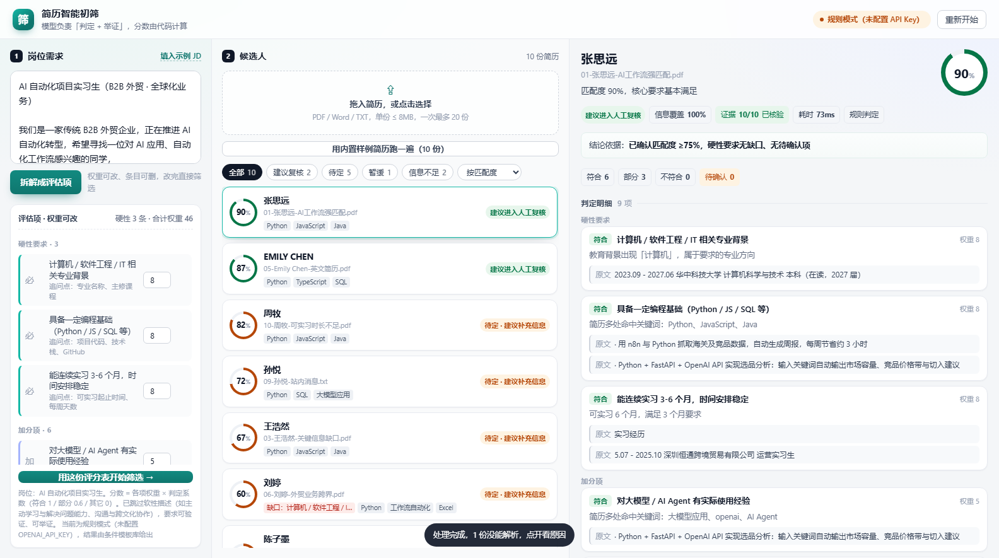

# 简历智能初筛助手

> 给 HR 用的 AI 简历初筛工具：把岗位 JD 拆成可判定的评估项，逐份简历逐条判定、逐条举证，再给出「匹配度 + 结论 + 追问清单」。
>
> **核心主张：模型只做「判定 + 举证」，分数由代码计算。** 所以同一份简历重跑结果一致，每个分数都能点开看到依据。



---

## 1. 快速开始

```bash
npm install
npm start          # 打开 http://localhost:5178
```

不用配置任何 Key 就能跑（自动进入**规则模式**）。想用真模型，复制 `.env.example` 为 `.env` 并填入：

```
OPENAI_API_KEY=sk-xxx
OPENAI_BASE_URL=https://api.deepseek.com/v1   # 任何 OpenAI 兼容服务都行
OPENAI_MODEL=deepseek-chat
```

界面上三步走完一轮演示：

1. 点「填入示例 JD」→「① 拆解成评估项」（JD 用的是 BOSS 直聘上一份真实的 AI 实习生岗位）
2. 点「用内置样例简历跑一遍（10 份）」（也可以直接拖自己的 PDF / Word / 文本）
3. 点任意一位候选人，看逐条判定、证据原文、追问清单、触达话术

其它命令：

| 命令 | 作用 |
| --- | --- |
| `npm test` | 20 个自动化测试：打分规则、四态判定、证据校验、文档解析、HTTP 端到端 |
| `npm run demo:check` | 面试前 10 秒自检：拆 JD + 解析全部样例 + 打分，打印一张表，不起服务 |
| `npm run samples` | 重新生成 10 份样例简历（PDF / 扫描件 / 纯文本） |

---

## 2. 它解决什么问题

B2B 外贸企业的 HR 每天在招聘平台收几十份简历，人工初筛有三个痛点：

| 痛点 | 本工具的做法 |
| --- | --- |
| 重复劳动，一份简历看 2 分钟 | 一次贴 20 份，几秒钟出结论，人只看结论为「建议复核」的那几份 |
| 标准不一致，换个人结果就变 | JD 先固化成带权重的评分表，标准写在纸上、可复查 |
| 说不清为什么淘汰 | 每条判定都带简历原文证据，结论由短路规则给出，能逐条解释 |

关键设计取向：**这个工具不替 HR 做决定，它替 HR 做"看简历"这件体力活，并把判断依据摊开。** 最终点"联系"的永远是人。

---

## 3. 核心设计：模型判定，代码打分

```
JD 文本
  └─① 拆解 ──→ 评分表 rubrics[{id, group, label, type, weight, probe}]
                 （3-6 条硬性 / 2-4 条加分 / 0-3 条红线，HR 可改权重、可删）
简历文件
  └─② 解析 ──→ 纯文本（PDF / DOCX / TXT）
                 └─③ 逐条判定 ──→ met / partial / missing / unknown + 证据原文
                                    └─④ 代码打分 ──→ 匹配度 + 结论 + 追问清单
```

**为什么不让模型直接给分？** 三种做法对比过：

| 做法 | 问题 |
| --- | --- |
| 模型直接输出「匹配度 85 分」 | 同一份简历两次跑出 78 / 91，无法解释，改一条 JD 权重分数乱跳 |
| 模型逐条打分再平均 | 模型对"这条值几分"没有稳定标尺，权重也管不住 |
| **模型只输出四态判定，分数用代码加权算**（采用） | 分数可复现、权重可调、单个判定错误不会污染总分，且能回归测试 |

模型负责它擅长的语义理解（"这段经历算不算用了 LangChain"），代码负责它擅长的确定性计算（加权、阈值、结论短路）。

### 3.1 第四种判定：`unknown`（本项目的关键设计）

绝大多数简历筛选工具只有"符合 / 不符合"。但简历的真实情况是：**没写 ≠ 不具备**。

- 王浩然没写可实习时长 → 不一定是只能实习 1 个月，可能只是没提
- 把这种项判成"不符合"，会误杀大量合格候选人；判成"符合"又会放过不合格的

所以判定分四态，`unknown` 单独一档，并且：

1. `unknown` **不计分，但计入覆盖率**（信息覆盖率 = 能判断的权重 / 总权重）
2. 覆盖率 < 50% 时不判"不合适"，而是判 **「信息不足 · 需补充简历」**——这类简历应该退回重收，而不是淘汰
3. 每条 `unknown` / `partial` 自动生成一句**可以直接发给候选人**的追问

这就是界面上赵一鸣那份极简简历拿到的结论：32 分、信息覆盖率 41%、6 项待确认、结论是"信息不足"而不是"不合适"。

### 3.2 打分与结论规则

```
匹配度 = Σ(权重 × 折算系数) / Σ权重       折算：met=1.0  partial=0.6  missing=0  unknown=0
信息覆盖率 = 1 - Σ(unknown的权重) / Σ权重   红线项不进分母
```

结论不是阈值拍脑袋，而是按顺序短路，顺序本身是业务规则：

| 顺序 | 条件 | 结论 |
| --- | --- | --- |
| 1 | 命中红线 | 暂缓考虑 |
| 2 | ≥2 项硬性明确不满足 | 暂缓考虑 |
| 3 | 信息覆盖率 < 50% | 信息不足 · 需补充简历 |
| 4 | 恰有 1 项硬性不满足 | 匹配度 < 50% → 暂缓；否则 → 待定 |
| 5 | 匹配度 ≥ 75% 且硬性无 partial/unknown | 建议进入人工复核 |
| 6 | 硬性有部分满足 / 待确认 | 待定 · 建议补充信息（并附追问） |

注意第 5 条：**只有硬性要求一条都不缺，才配拿"建议进入人工复核"。** 78 分但有一项硬性没写清楚，结论只能是"待定"——宁可多问一句，不要放过一个错的人。

### 3.3 举证校验

模型给出的每条判定都要附一段简历原文。这段原文会被拿回去做**包含性校验**（忽略空白与标点）：找不到的片段标为"未核验"（界面上是琥珀色底），提示"这句话模型是编的"。

这既是防幻觉，也是一个能在面试里讲的技术点：*LLM 的输出不只要 schema 合法，还要能被原文档验证。*

---

## 4. 架构

```
┌──────────────────────── 浏览器（无构建步骤，原生 ES Module）────────────────────────┐
│  public/index.html + styles.css + app.js                                          │
│  三栏：岗位需求 / 候选人列表 / 判定详情      900ms 轮询进度，不用 SSE                  │
└───────────────────────────────────┬──────────────────────────────────────────────┘
                                    │ fetch JSON / FormData
┌───────────────────────────────────▼──────────────────────────────────────────────┐
│  server/index.js  Express 5，单进程单端口                                           │
│    /api/jd/parse      JD → 评分表                                                │
│    /api/screen        收简历（或直接指定内置样例）→ 202 + runId，后台并发处理           │
│    /api/run/:id       轮询批次进度                                                │
│    /api/candidate/:id 单人完整判定 + 证据 + 追问                                    │
│    /api/export/:id.csv 导出（带 BOM，Excel 直接打开不乱码）                          │
├──────────────────────────────────────────────────────────────────────────────────┤
│  pipeline/jd.js          decomposeJD()    模型拆 JD，失败/条目不足则降级规则模板         │
│  pipeline/resume-parse   PDF(pdfjs) / DOCX(mammoth) / TXT，扫描件报 SCANNED_PDF      │
│  pipeline/match.js       解析 → 判定 → 规则补字段 → 打分 → 证据校验 → 总结 + 追问       │
│  llm/provider.js         OpenAI 兼容调用，JSON 模式失败自动重试、超时重试               │
│  scoring/rules.js        纯函数：加权打分、结论短路、证据校验、规则判定引擎              │
│  store.js                内存 Map + 防抖落盘 data/runs.json                          │
└──────────────────────────────────────────────────────────────────────────────────┘
```

目录：

```
server/          后端（config / llm / pipeline / scoring / store / index）
public/          前端（一个 HTML + 一份 CSS + 一份 JS，无打包）
samples/         10 份刻意埋坑的样例简历
test/            node:test 自动化测试（规则 / 解析 / HTTP 端到端）
scripts/         gen-samples 生成器、selftest 自检、ui-shot 与 zoom 截图工具
docs/            设计说明、演示脚本
```

---

## 5. 接口

| 方法 | 路径 | 说明 |
| --- | --- | --- |
| GET | `/api/health` | 当前模式（llm / rule）、模型配置、并发数、样例数 |
| GET | `/api/sample-jd` | 内置示例 JD（BOSS 直聘真实岗位） |
| GET | `/api/samples` | 内置样例列表 `[{name,size,kind}]` |
| POST | `/api/jd/parse` | `{jd}` → `{role, rubrics[], mode, warning}` |
| POST | `/api/screen` | multipart `files[]` + `jd`(JSON 字符串)；或 JSON `{jd, samples:["文件名"]}` → `202 {runId,total,mode}` |
| GET | `/api/run/:id` | 批次状态与候选人摘要（轮询用） |
| GET | `/api/candidate/:id` | 单人完整结果：items[]（含 evidence[]）、decision、summary、questions |
| GET | `/api/export/:id.csv` | CSV 导出 |

错误语义：`422` 输入不可用（JD 太短、没有评分表、样例不存在）、`413` 文件超限、`404` 资源不存在；每条错误都带一句人话 `hint`。

---

## 6. 样例简历：每一份都对应一种真实情况

10 份样例不是随机内容，是照着"人工初筛最容易看走眼的情况"设计的（规则模式下的实测结论）：

| # | 文件 | 埋的坑 | 预期结论 |
| --- | --- | --- | --- |
| 01 | 张思远 · AI 工作流强匹配 | 正常强候选人 | 90% 建议进入人工复核 |
| 02 | 李佳怡 · 专业与技能不符 | 大专 + 市场营销 + 无编程 | 42% 暂缓考虑 |
| 03 | 王浩然 · 关键信息缺口 | 经历不错但没写实习时长 | 67% 待定（该项待确认） |
| 04 | 陈子墨 · 转专业自学 | 专业不符但自学做得很实 | 54% 待定（专业不符 1 项） |
| 05 | Emily Chen · 英文简历 | 全英文，考察信息抽取稳健性 | 87% 建议进入人工复核 |
| 06 | 刘婷 · 外贸业务跨界 | 外贸很强、计算机背景弱 | 60% 待定 |
| 07 | 扫描件简历 | 图片 PDF，没有文本层 | 解析失败，界面单独标出并说明要 OCR |
| 08 | 赵一鸣 · 信息极简 | 只有学校和大三，字数 < 80 | 32% 信息不足 · 需补充简历 |
| 09 | 孙悦 · 站内消息 | 招聘平台聊天式的短文本 | 72% 待定 |
| 10 | 周牧 · 可实习时长不足 | 只写"能实习 2 个月" | 82% 但硬性 partial → 待定 |

07 是最能说明问题的一份：**读不出来的简历必须被人看到，而不是被静默丢掉，也不是被算成 0 分。** 所以它单独一条错误卡片，写明原因和下一步。

---

## 7. 关键取舍

| 决定 | 没选的方案 | 为什么 |
| --- | --- | --- |
| Express + 原生 HTML/CSS/JS，无构建步骤 | React + Vite | 现场演示第一优先级是"一定能跑"。少一层打包 = 少一类现场故障，改一行 CSS 刷新即可 |
| 前端轮询进度 | SSE / WebSocket | 3 秒就跑完的批次不值得引入长连接和断线重连逻辑 |
| 后端并发 3 张简历 | 串行 / 全并发 | 串行太慢，全并发容易撞模型限流。3 是"够快且不炸"的经验值 |
| 单进程单端口，数据落 JSON 文件 | Postgres + 队列 | Demo 阶段零部署成本；`store.js` 是唯一持久化出口，换数据库只改一个文件 |
| 规则引擎与 LLM 同 schema 输出 | 只在 LLM 不可用时返回报错 | 无 Key 也能演示完整链路；同时它天然是"模型判定的对照组"，能现场对比两种模式 |
| 解析失败抛出结构化 `ParseError` | 返回空字符串继续走 | 空文本会让所有项变 `unknown`，看起来像"简历不行"，其实是解析失败——必须在 UI 上说清楚 |
| `pdfjs-dist` legacy 构建 | 系统 `pdftotext` | 纯 Node 依赖、零外部二进制，`npm install` 完就能跑 |

---

## 8. 降级与容错

| 故障 | 表现 | 处理 |
| --- | --- | --- |
| 没有 `OPENAI_API_KEY` | 顶栏「规则模式（未配置 API Key）」 | 自动走规则引擎，全流程可用 |
| 模型超时 / 5xx | 该份简历标记 `degraded` | 单份降级为规则判定，不影响整批 |
| 模型不支持 JSON 模式（400/422） | — | 自动去掉 `response_format` 重试一次 |
| 扫描件 / 加密 PDF | 解析失败 | 单独错误卡片 + "需要 OCR"提示 |
| 单份处理异常 | 其余继续 | 独立 try/catch，批次照常收口 |
| 端口被占用 | — | 自动 +1 重试，并把真实地址打到控制台 |

---

## 9. 合规边界（这条是刻意划的）

- **不做招聘平台抓取**。本工具不登录、不爬取 BOSS 直聘等平台的数据。简历来源只有两个：HR 手上已有的文件、或用户自己拖进来的文件。
- 内置样例简历全部为**虚构人物**，由脚本生成，与真实候选人无关。
- 工具输出只作为初筛建议，不自动发送拒信、不自动淘汰；最终决定始终由人做出。
- 简历文本只在本地进程内处理；配置真模型时才会把简历正文发往所配置的模型服务（这一点在 README 里明说，而不是藏着）。

---

## 10. 已知限制与下一步

- **工作年限/实习时长靠规则解析**，遇到"每周 3 天、共 6 个月"这类复合表述会判成部分符合，需要人看一眼。
- **中英混排 PDF 的断行**已经处理（按 `hasEOL` 断行 + 自写折行生成器），但双栏排版的简历仍可能串行。
- **图片/扫描件不做 OCR**：这是有意不做，OCR 质量不稳会污染判定；正确做法是提示 HR 换一份文本版。
- 下一步优先级：① 人工复核的结论回写（做成人机一致性统计）② 同岗位历史批次对比 ③ 评分表模板复用 ④ 多用户与权限。

---

## 11. 开发说明

- 服务端只用 Node 内置能力 + 4 个依赖（express / multer / mammoth / pdfjs-dist），`engines.node >= 20`。
- `scripts/ui-shot.mjs` 用 CDP 驱动无头 Chrome 走完主流程并截图到 `shots/`，同时打印关键元素的几何尺寸，用来代替肉眼确认"没有溢出/没有重叠"。这是开发期工具，不参与运行时。
- 设计决策的完整来龙去脉见 `docs/specs/2026-10-22-ai-recruit-screener-design.md`；现场讲解脚本见 `docs/demo-script.md`。
